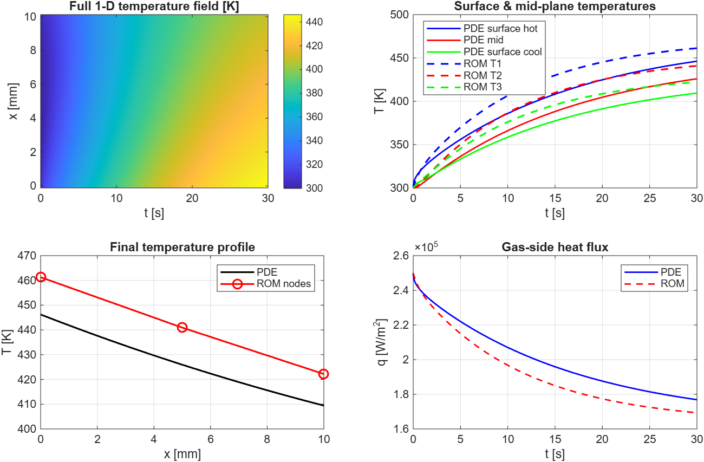

# Heat Transfer PDE vs Reduced-Order Model

Summary of a MATLAB demonstration of 1-D unsteady heat conduction using the Method of Lines, compared against a 3-node reduced-order thermal network (ROM).

## Overview

This example shows how a high-fidelity 1-D heat-conduction PDE can be reduced to a low-order thermal network suitable for system-level simulation, controls co-simulation, or real-time applications.


## Physical Setup

A steel-like wall of thickness **L = 0.01 m** (10 mm) is modeled with the following parameters:

| Parameter       | Value          | Meaning                          |
|-----------------|----------------|----------------------------------|
| k               | 40 W/m·K       | Thermal conductivity             |
| ρ               | 7800 kg/m³     | Density                          |
| c_p             | 500 J/kg·K     | Specific heat                    |
| α = k / (ρ c_p) | —              | Thermal diffusivity              |
| T_init          | 300 K          | Uniform initial temperature      |
| T_hot           | 800 K          | Hot gas temperature              |
| T_cool          | 350 K          | Coolant temperature              |
| h_hot           | 500 W/m²·K     | Gas-side convection coefficient  |
| h_cool          | 2000 W/m²·K    | Coolant-side convection coefficient |

**Boundary conditions (Robin / convective):**

- Left (x = 0):  
  −k ∂T/∂x = h_hot (T_hot − T)

- Right (x = L):  
  −k ∂T/∂x = h_cool (T − T_cool)

## Full 1-D PDE: Method of Lines

The governing equation is:

```
∂T/∂t = α ∂²T/∂x²
```

**Discretization:**

- Spatial grid: N_x = 41 points, uniform spacing Δx = L / (N_x − 1)
- Time integration: Forward Euler with Δt = 0.002 s up to T_final = 30 s

**Interior update (second-order central difference):**

```
T_i^{n+1} = T_i^n + Δt · α · (T_{i−1}^n − 2 T_i^n + T_{i+1}^n) / Δx²
```

**Boundary treatment (explicit Robin conditions):**

```
T_1 = [(k/Δx) T_2 + h_hot T_hot] / (k/Δx + h_hot)
```

(and the analogous expression for the right surface).

## Reduced-Order Model: 3-Node Thermal Network

The wall is approximated by three thermal masses:

| Node | Location              | Capacity C (per unit area) |
|------|-----------------------|----------------------------|
| 1    | Gas-side surface      | ρ c_p (L/6)                |
| 2    | Bulk / mid-wall       | ρ c_p (L/3)                |
| 3    | Coolant-side surface  | ρ c_p (L/6)                |

**Conductances (per unit area):**

- G_12 = G_23 = k / (L/2)   — conduction between nodes
- G_h = h_hot ,  G_c = h_cool   — convection to the fluids

The linear state-space form is:

```
dT/dt = A_rom · T + B_rom · u
```

where u = [T_hot ; T_cool] and the matrices are constructed from the energy balances on each node.

## Method of Lines — Details

The Method of Lines converts a PDE into a system of ODEs by discretizing only the spatial derivatives, leaving time continuous. The resulting semi-discrete system is then integrated with an ODE solver (here, forward Euler).

### Spatial Discretization

Second-order central difference at interior nodes:

```
∂²T/∂x² |_i ≈ (T_{i−1} − 2 T_i + T_{i+1}) / Δx²
```

This yields the semi-discrete ODEs:

```
dT_i / dt = α (T_{i−1} − 2 T_i + T_{i+1}) / Δx²
```

### Boundary Treatment

True Method of Lines would incorporate the boundary nodes into the ODE system (via one-sided differences or ghost points) or eliminate them algebraically.

This implementation instead applies an **explicit algebraic update** after each interior step:

```
T_1 = [(k/Δx) T_2 + h_hot T_hot] / (k/Δx + h_hot)
```

This enforces a first-order one-sided flux balance at the surface. It is simple but is **not a pure Method of Lines**: the boundary nodes are reset algebraically rather than being part of the ODE system. As a result, spatial accuracy drops to first order at the boundaries.

### Time Integration

Forward Euler on the interior nodes:

```
T_i^{n+1} = T_i^n + Δt · α · (T_{i−1}^n − 2 T_i^n + T_{i+1}^n) / Δx²
```

followed by the algebraic surface-temperature updates.

### Stability and Accuracy

- Conditional stability: Δt ≲ Δx² / (2α)
- Spatial accuracy: O(Δx²) interior, O(Δx) at boundaries
- Temporal accuracy: O(Δt)

## Key Takeaways

- A 41-state PDE is reduced to a 3-state linear system.
- The ROM is validated directly against the PDE solution on the same time grid.
- Thermal networks of this type are standard for real-time and controls co-simulation.
- The capacity lumping (L/6, L/3, L/6) is a simple heuristic; more rigorous methods (moment matching, POD, finite-volume lumping) can improve accuracy.

## Limitations of This Implementation

- Boundary treatment is an explicit algebraic approximation, not a fully consistent finite-volume flux balance.
- Forward Euler is first-order and conditionally stable.
- The ROM is linear and does not capture temperature-dependent properties or radiation.

---
